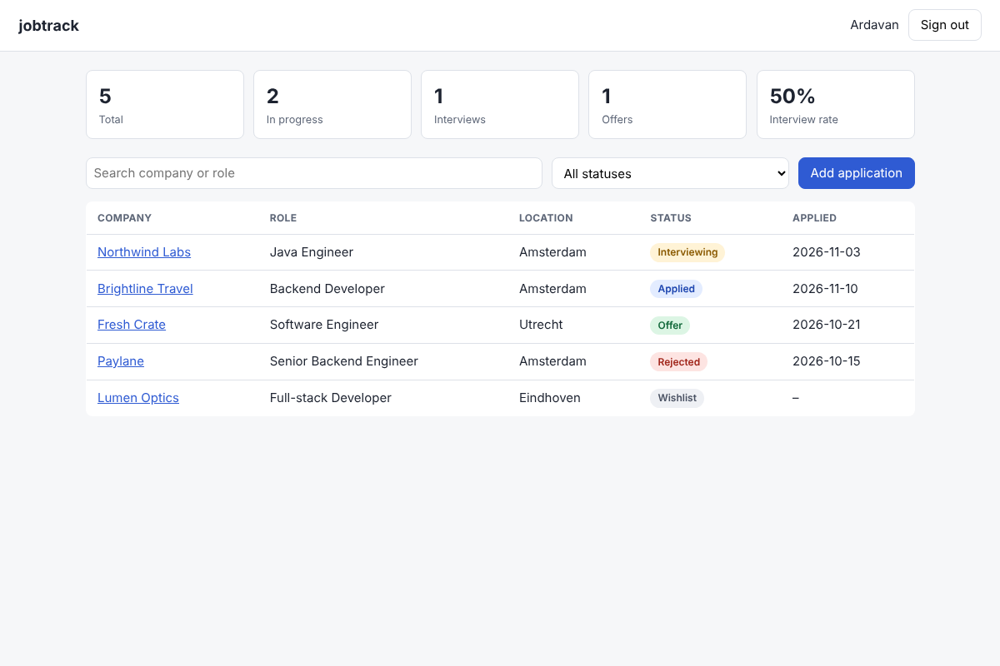
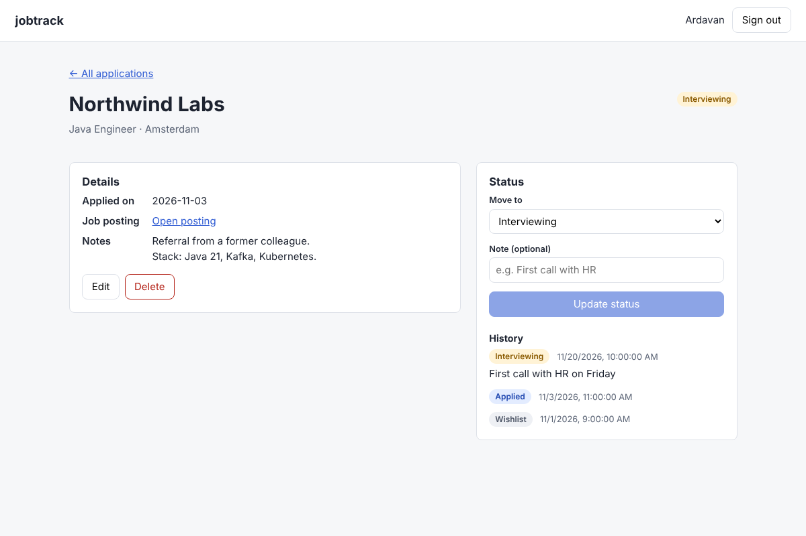
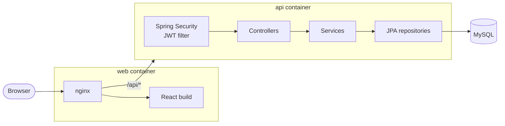

# jobtrack

[](https://github.com/ARDAVAN39/jobtrack/actions/workflows/ci.yml)

A full-stack app for keeping track of job applications: where you applied, where each one stands,
and how your search is going. A Spring Boot API with JWT authentication and MySQL, and a React +
TypeScript frontend served by nginx.





*Screenshots use made-up company names.*

## Features

- Sign up and sign in; every user only ever sees their own applications.
- Add applications with company, role, location, posting URL, date and notes.
- Move an application through `Wishlist → Applied → Interviewing → Offer` (or `Rejected`,
  `Withdrawn`). Every change is kept in a timeline, with an optional note.
- Search by company or role, filter by status, page through results.
- A summary: totals, applications in progress, and the interview rate (share of sent applications
  that led to an interview or offer).

## Run it

You need Docker.

```bash
docker compose up --build
```

Open <http://localhost:8080> and create an account. The API documentation is served by the API
container at `/swagger-ui.html` (not exposed by default; see `compose.yaml`).

### Development

```bash
# terminal 1: database
docker compose up mysql

# terminal 2: API on :8080
cd backend && mvn spring-boot:run

# terminal 3: frontend on :5173, forwarding /api to :8080
cd frontend && npm install && npm run dev
```

## Architecture



```
backend/    Spring Boot 3.5, Java 21
  auth/          registration, login, token issuing
  applications/  the domain: entity, status history, search, stats
  config/        security, JWT settings, clock
  web/           error handling
frontend/   React 19, TypeScript, Vite
  api/           typed client for the REST API
  auth/          sign-in state
  components/    form, status badge, summary
  pages/         list, detail, login
```

## API

| Method | Path | Description |
|---|---|---|
| `POST` | `/api/auth/register` | Create an account; returns a token. |
| `POST` | `/api/auth/login` | Exchange email and password for a token. |
| `GET` | `/api/me` | The signed-in user. |
| `GET` | `/api/applications?status=&q=&page=&size=` | Your applications, most recently updated first. |
| `POST` | `/api/applications` | Add an application. |
| `GET` | `/api/applications/{id}` | One application with its status history. |
| `PUT` | `/api/applications/{id}` | Edit it. Send the `version` you loaded. |
| `PATCH` | `/api/applications/{id}/status` | Move it to another status, with an optional note. |
| `DELETE` | `/api/applications/{id}` | Delete it. |
| `GET` | `/api/applications/stats` | Counts per status and interview rate. |

Everything except register and login needs `Authorization: Bearer <token>`. Errors are
[RFC 9457](https://www.rfc-editor.org/rfc/rfc9457) problem details; validation errors include an
`errors` object with one message per field, which the frontend shows next to the matching input.

## Design decisions

**Stateless JWT authentication with Spring Security's own JWT support.** Tokens are signed with
HS256 using Nimbus, which already ships with Spring Security's resource server, so no extra JWT
library is needed. The API keeps no session. The secret must be at least 32 bytes or the
application refuses to start.

**Data is scoped by user in every query.** The repository has no method that loads an application
by id alone; every lookup includes the user id from the token. Asking for someone else's
application returns 404, the same as one that does not exist, so ids cannot be probed.

**Login does not reveal which emails have accounts.** A wrong password and an unknown email get the
same message, and an unknown email is still checked against a dummy BCrypt hash, so both take
the same time.

**Edits use optimistic locking.** The client sends the `version` it loaded. If the application has
changed since (another tab, another device), the save is refused with 409 instead of silently
overwriting the newer data. The frontend offers to reload.

**The status and its history cannot disagree.** The status only changes through one method on the
entity, which also appends the timeline entry. Moving to `Applied` without a date fills in today.

**Search treats user input literally.** `%` and `_` typed into the search box are escaped before
going into a `LIKE` query, so `100%` finds "100%" instead of everything.

**One origin.** nginx serves the React build and forwards `/api` to the API. In development, Vite
does the same forwarding. The browser never makes a cross-origin request, so there is no CORS
configuration to get wrong.

**Validation on both sides.** The frontend checks the obvious things for instant feedback; the API
checks everything again with Bean Validation and is the authority.

## Tests

```bash
cd backend && mvn verify        # needs Docker for the MySQL integration test
cd frontend && npm test
```

Backend:

- `JobApplicationTest`: status changes, history, applied date, input cleanup, search escaping.
- `TokenServiceTest`: tokens round-trip through the real decoder; expired, foreign-issuer and
  wrongly signed tokens are refused.
- `JobApplicationControllerTest`: the HTTP layer with the real security configuration: 401
  without a token, user id taken from the token, per-field validation errors.
- `JobtrackIntegrationTest`: the running application against MySQL in Testcontainers: register,
  login, create, edit, stale-version conflict, status history, search, stats, and one user
  trying to read, change and delete another user's application.

Frontend (Vitest and Testing Library): the API client, the application form, the login page and
the applications list.

CI also builds the Docker images, starts the whole stack and runs
[`scripts/smoke-test.sh`](scripts/smoke-test.sh) through nginx.

## Limitations and next steps

- **Token storage.** The token is kept in `localStorage`, which JavaScript on the page can read. An
  httpOnly cookie would protect it from XSS but brings CSRF protection back into scope. React
  escapes rendered text, which limits the XSS risk, but it is a trade-off worth knowing.
- **No refresh tokens.** A token lasts 8 hours; after that the user signs in again.
- **No rate limiting** on login. In production this belongs in front of the API.
- **Dates are UTC.** "Applied today" uses the server's UTC date, which can differ from the user's
  date late at night.

## Tech stack

Java 21 · Spring Boot 3.5 · Spring Security (OAuth2 resource server, JWT) · Spring Data JPA ·
Hibernate · MySQL 8.4 · Flyway · React 19 · TypeScript · Vite · TanStack Query · React Router ·
Vitest · Testing Library · Testcontainers · nginx · Docker · GitHub Actions

## License

[MIT](LICENSE)
